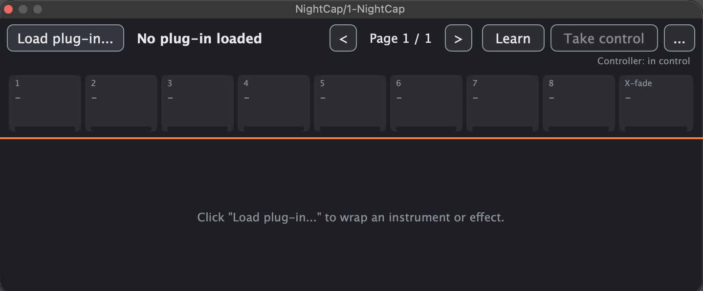
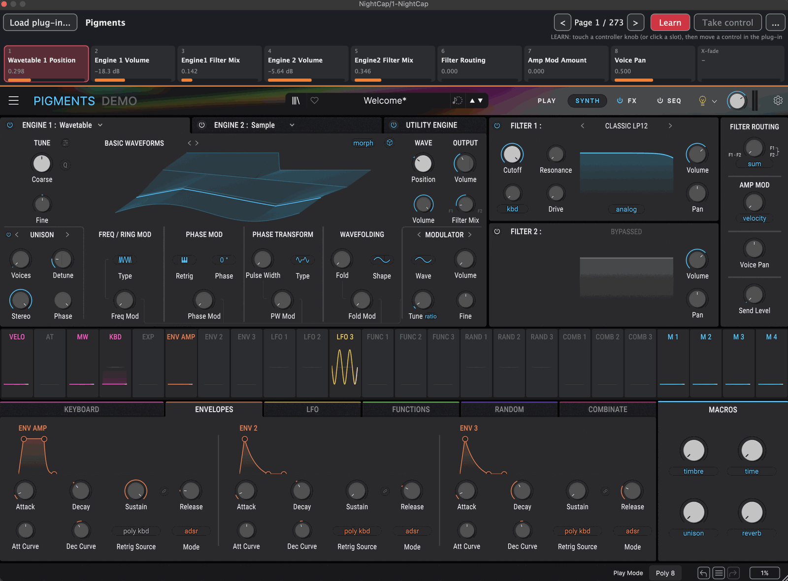

# The NightCap wrapper plug-ins

**NightCap** (for instruments) and **NightCap FX** (for effects) are AU and VST3 plug-ins that load another plug-in inside
themselves and put **all** of its parameters on the Nocturn controller, in pages of 8. You don't need them for Ableton Live's
own devices, or for plug-ins with up to 128 parameters, because the Live script handles those. Use the wrappers when:

- you use a DAW other than Ableton Live (REAPER, Bitwig, Logic, Bespoke, ...), or
- a plug-in has more parameters than Live will expose (Live's limit is 128). For example, Arturia Pigments has over 2,000,
  which the wrapper lays out across 273 pages.

Build them with `sh install.sh --with-wrapper` (needs `brew install cmake`). The plug-ins are installed to
`~/Library/Audio/Plug-Ins/Components` (AU) and `~/Library/Audio/Plug-Ins/VST3` (VST3). NightCapBridge must be running.

## Getting started

1. Insert **NightCap** on an instrument track (or **NightCap FX** on an audio or effect track) and open its window.
2. Click **Load plug-in...** and pick the plug-in you want. The first time, NightCap scans your AU and VST3 plug-ins (this can
   take a minute; progress is shown in the status line). Use **... → Rescan plug-ins** after installing new ones.
3. The plug-in's own window appears below NightCap's bar, and its parameters are laid out on the 8 knob slots.

## The window

| Part | What it does |
|---|---|
| **Load plug-in...** | Choose the plug-in to wrap (grouped by manufacturer). The name of the loaded plug-in is shown next to it. |
| **< Page 1 / 273 >** | Step through the pages of 8 parameters. The controller's Page − / + buttons do the same. |
| **Learn** | Assign a control from the plug-in to a knob (see [Learn](#learn)). It turns red while active. |
| **Take control** | Gives the controller to this wrapper. Greyed out when this wrapper already has it. |
| **...** | Reset mapping to all parameters, Rescan plug-ins, Unload plug-in, Give control back to Live / DAW. |
| Status line | Where the controller is: *in control* (this wrapper), *controlling Live*, *used by another NightCap instance*, or *NightCapBridge not running*. Shows Learn instructions while Learn is on. |
| Slots **1–8** | The 8 parameters on the current page: name, value, and a bar showing the position. The knob you're touching is highlighted orange. |
| **X-fade** | The parameter learned for the controller's crossfader (`–` when none). |
| Below the bar | The wrapped plug-in's own window, exactly as it normally looks. |

## Controller layout in the wrapper

| Control | Action |
|---|---|
| Encoders 1–8 | The 8 parameters on the current page |
| Encoder touch | Highlights the slot; picks the knob for Learn |
| Speed dial | Fine-adjusts the last knob you used (10× finer) |
| Crossfader | The learned crossfader parameter |
| Buttons 1–8 | Jump to page 1–8 |
| Learn | Switch Learn on or off |
| View | Reset the last knob's parameter to its default |
| Page − / + | Previous / next page |
| User / FX | Previous / next preset of the wrapped plug-in |
| Inst | Bypass the wrapped plug-in |
| Mixer | Give the controller back to Live or your DAW |

The LED rings follow the parameter values, and the button LEDs show the current page, Learn and bypass.

## Learn

By default every parameter of the plug-in is laid out in order. Learn lets you put the controls you actually use on the first
pages, in your own order:

1. Press **Learn** (on the controller or in the window).
2. Touch a controller knob, click one of the 8 slots, or move the crossfader, to choose where the control goes.
3. Move the control you want in the plug-in's own window. It is assigned straight away, and Learn switches off.

Learned layouts are saved per plug-in in `~/Library/Application Support/NightCap/Mappings/`, and used every time you load
that plug-in, in any project. To start over, use **... → Reset mapping to all parameters**.

## Which wrapper gets the controller

- **Ableton Live:** selecting a NightCap device hands the controller to it automatically; selecting any other device hands it
  back to the Live script. **Mixer** on the controller also hands it back.
- **Other DAWs:** opening a wrapper's window gives it the controller, as does **Take control**. With several wrappers in a
  project, the one you opened or clicked last has it.

## Automation and saving

- The wrapper exposes the wrapped plug-in's first 127 automatable parameters to your DAW (named after the plug-in's own
  parameters), so automation and your DAW's generic controls work as normal.
- Your project saves the wrapped plug-in, its settings, the learned mapping, the current page and the bypass state.

## If something goes wrong

- **The status line says "NightCapBridge not running":** start `~/Applications/NightCapBridge/NightCapBridge`. The wrapper
  reconnects on its own within a couple of seconds.
- **A plug-in doesn't appear in the Load menu:** use **... → Rescan plug-ins**.
- **A host fails while scanning NightCap**, or a plug-in won't load: see
  [Troubleshooting](../README.md#troubleshooting) and the plug-in log at `~/Library/Logs/NightCap/NightCap Plugin.log`.
